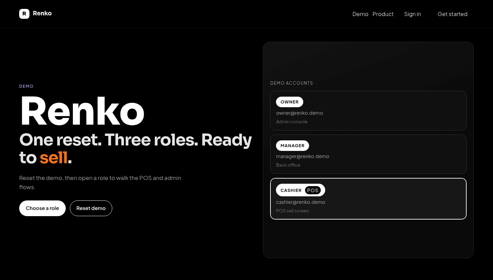
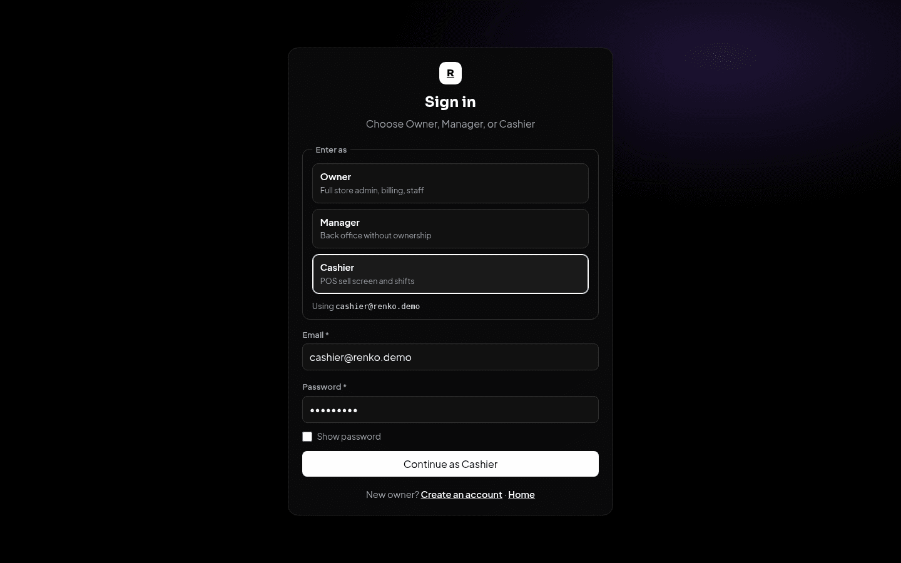
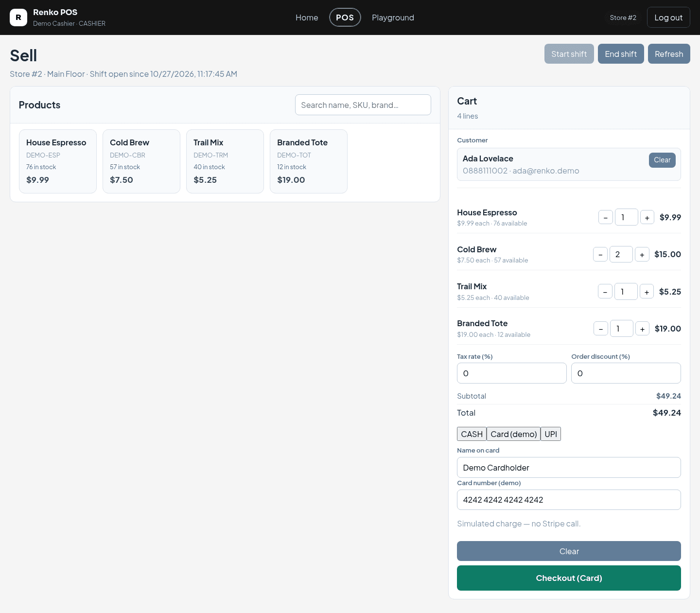
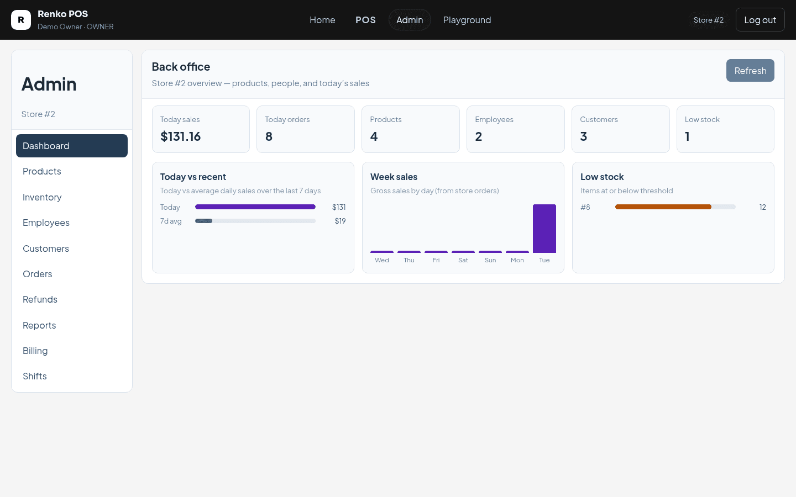
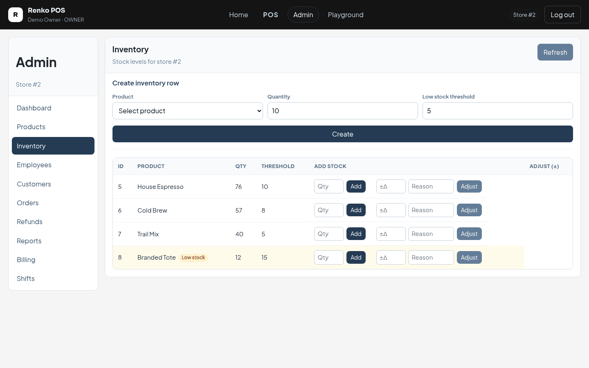
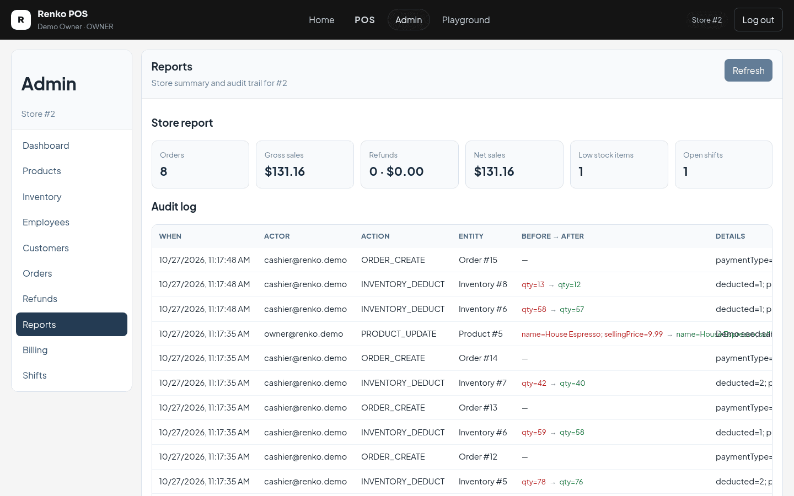
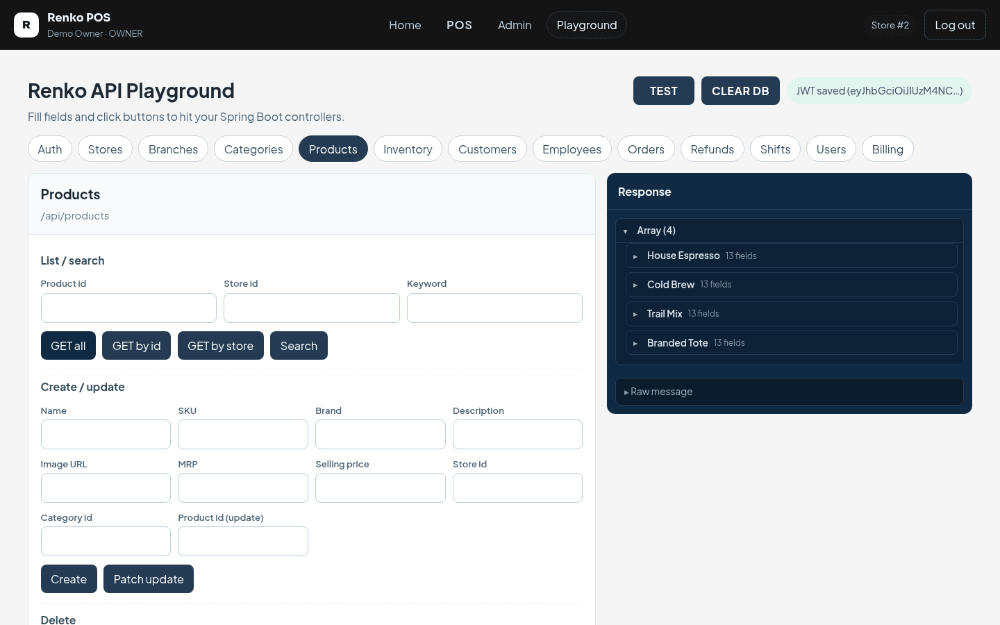

# Renko SaaS POS System

Microservice POS demo: Spring Boot domain services, nginx API gateway, React SPA, six MySQL databases, Apache Kafka.

**You only need Docker.** No local Java, Maven, Node, or MySQL install required for the default path.

## Screenshots

Captured from a local run of all six services behind the gateway after **Reset demo** (demo store, 1440×900).

| | |
|---|---|
|  |  |
| **Landing** — demo accounts and one-click reset across all services | **Sign in** — pick Owner, Manager or Cashier to auto-fill credentials |
|  |  |
| **POS** — cashier sell screen (sales + catalog services) with an open shift and a four-line cart | **Admin dashboard** — today's sales, week chart and low-stock alerts |
|  |  |
| **Inventory** — stock levels from catalog-service, restock and adjustments | **Reports** — report-service summary and the cross-service audit trail |
|  | |
| **API Playground** — call each endpoint through the gateway and inspect the JSON response | |

## Quick start

```bash
git clone https://github.com/Renis032/SaaSPosSystem.git
cd SaaSPosSystem
docker compose up --build
```

First build can take several minutes (Maven downloads + frontend build).

Open **http://localhost:8080** → click **Reset demo** → sign in:

| Role | Email | Password |
|------|--------|----------|
| Owner | `owner@renko.demo` | `Demo1234!` |
| Cashier | `cashier@renko.demo` | `Demo1234!` |
| Manager | `manager@renko.demo` | `Demo1234!` |

Stop: `Ctrl+C` or `docker compose down`  
Wipe data and recreate DBs: `docker compose down -v`

Optional overrides: `cp .env.example .env` then edit.

## What you get

| URL | What |
|-----|------|
| http://localhost:8080 | UI |
| http://localhost:5000 | API gateway |
| http://localhost:5001–5006 | Individual services (debug) |
| localhost:3306 | MySQL (`pos_auth` … `pos_report`) |
| localhost:9092 | Kafka (audit events) |

```text
Browser → frontend (:8080) → gateway (:5000)
                              ├─ auth      → pos_auth
                              ├─ store     → pos_store  ──┐
                              ├─ catalog   → pos_catalog ─┼─ Kafka topic renko.audit → report
                              ├─ sales     → pos_sales  ──┘
                              ├─ billing   → pos_billing
                              └─ report    → pos_report
```

Suggested demo: Owner admin → Cashier POS (shift, sell, PDF receipt) → Manager reports.

## Prerequisites

- [Docker](https://docs.docker.com/get-docker/) + Docker Compose v2  
- ~8 GB free RAM recommended for the first build

## Repo layout

```text
gateway/                 nginx API gateway
services/
  auth-service/          /auth, /api/users, /api/dev
  store-service/         stores, branches, employees
  catalog-service/       products, categories, inventory
  sales-service/         orders, refunds, customers, shifts
  billing-service/       subscriptions / Stripe
  report-service/        reports, audit logs (Kafka consumer)
frontend/                React + Vite SPA
scripts/mysql-init/      creates the six databases on first MySQL start
docker-compose.yml
```

Cross-service links use Long IDs + HTTP (`RestClient`). JWT carries `userId`, `storeId`, `email`, `authorities`.  
Audit trail: sales / catalog / store publish JSON to Kafka topic `renko.audit`; report-service consumes and stores rows. If Kafka is down, those services fall back to `POST /api/audit-logs`.

## Troubleshooting

| Symptom | Fix |
|---------|-----|
| Port already in use | Stop local apps on `8080` / `5000`–`5006` / `3306`, or change ports in `.env` |
| Old monolith DB / weird schema | `docker compose down -v` then `docker compose up --build` |
| Reset demo fails / 502 | Wait until all containers are healthy (`docker compose ps`), then retry Reset |
| Audit logs empty | Confirm Kafka is up (`localhost:9092`) or set `KAFKA_ENABLED=false` so HTTP fallback is used |
| Orphan containers warning | `docker compose up --build --remove-orphans` |

## Local development (optional)

Only if you want to run services outside Docker. Needs Java 21, Node 20+, MySQL 8+.

```bash
# MySQL + Kafka (easiest):
docker compose up mysql kafka -d

# Then one terminal per service:
cd services/auth-service && ./mvnw spring-boot:run
cd services/store-service && ./mvnw spring-boot:run
# … catalog :5003, sales :5004, billing :5005, report :5006

# Gateway:
docker run --rm --network host \
  -v "$PWD/gateway/nginx.local.conf:/etc/nginx/nginx.conf:ro" \
  nginx:1.27-alpine

# Frontend:
cd frontend && npm install && npm run dev
```

Helper scripts (optional): `scripts/ensure-mysql.sh`, `scripts/ensure-kafka.sh`, `scripts/run-services.sh`, `scripts/stop-services.sh`.

## Authorship

- **Backend** — mostly hand-written (domain, security, tenancy, orders, inventory, billing, tests).
- **Frontend** — built with AI assistance on top of that API.

## CI

GitHub Actions runs selected backend tests and the frontend production build (`.github/workflows/ci.yml`).
